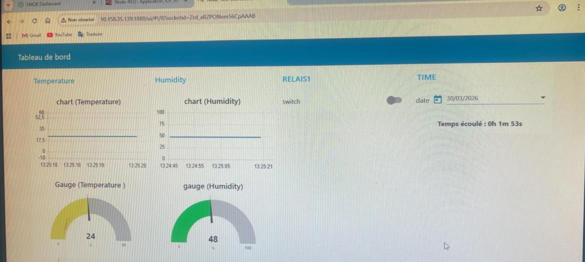

# MQTT Architecture Lab — Broker Security, TLS & QoS Analysis

Building a complete IoT chain (**ESP32 → EMQX broker → Node-RED**) and analysing it at packet level with **Wireshark**: what an attacker can read over plain MQTT, what TLS protects, and how QoS levels trade reliability against network load.

> Academic lab — IoT module, ENSA Fez (GSCSI).

   

---

## Environment

| Layer | Tool |
|---|---|
| Broker | **EMQX** in **Docker** on a Debian VM (TCP listener exposed on host port 1885, TLS on 8883, WebSocket on 8083, dashboard on 18083) |
| Clients | MQTTX (desktop), EMQX WebSocket client |
| Application server | **Node-RED** (Docker) |
| Device | ESP32 on Wokwi (MicroPython) |
| Analysis | **Wireshark** |

## 1. Securing the broker

- Built-in database **authentication** with dedicated client accounts — only authorised devices can publish or subscribe.
- Studied the **listeners** (TCP, SSL/TLS, WebSocket): each one is an entry point with its own protocol and port.

## 2. Plain MQTT vs MQTT over TLS — Wireshark findings

| | MQTT over TCP (port 1885) | MQTTS (port 8883) |
|---|---|---|
| CONNECT packet | **Client ID, username and password readable in clear text** | Not visible |
| Topics & JSON payload | Readable | Only "Application Data" (encrypted) |
| What Wireshark shows | Full MQTT decode | TCP + TLS handshake only |

**Conclusion:** for a sensitive sensor in a company, MQTTS is mandatory — it prevents industrial espionage and the injection of fake commands with stolen credentials. (Certificate verification was disabled only because the lab used a self-signed certificate; encryption stays active.)

## 3. Publish / Subscribe and QoS

Three clients: a WebSocket publisher (weather data in JSON) and two subscribers (TCP and TLS) on `lab/sensors/dht`; commands on `lab/action/relay`.

| QoS | MQTT frames observed | Behaviour | Typical use |
|---|---|---|---|
| 0 | PUBLISH | At most once, no acknowledgement — fastest, may be lost | Periodic temperature reading |
| 1 | PUBLISH + PUBACK | At least once — duplicates possible | Alarm notification |
| 2 | PUBLISH, PUBREC, PUBREL, PUBCOMP | Exactly once — slowest, heaviest | Industrial valve command, payment |

## 4. Node-RED dashboard and closed control loop

- MQTT in → **JSON parsing** → separate functions for temperature and humidity → **gauges** (instant value) and **charts** (history).
- Dashboard button → JSON command `{"infos": "relais1", "etat": "ON"}` → MQTT out on `lab/action/relay`.
- The ESP32 publishes sensor data and subscribes to the command topic: **every click on the dashboard switches the ESP32's LED immediately** — full IoT control loop validated.

## Skills demonstrated

MQTT · EMQX · Docker · TLS · broker authentication · Wireshark protocol analysis · QoS · Publish/Subscribe · Node-RED · JSON · ESP32 / MicroPython
