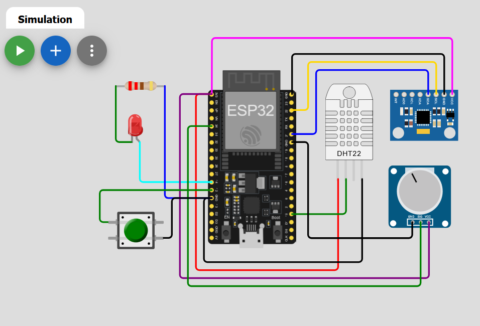
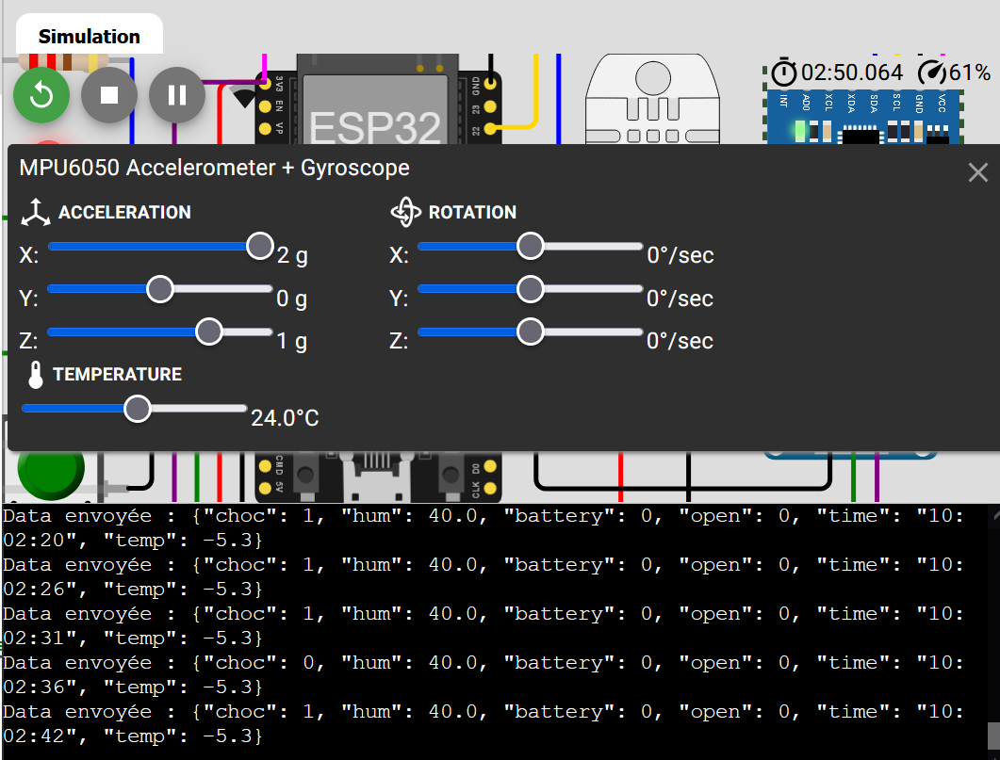
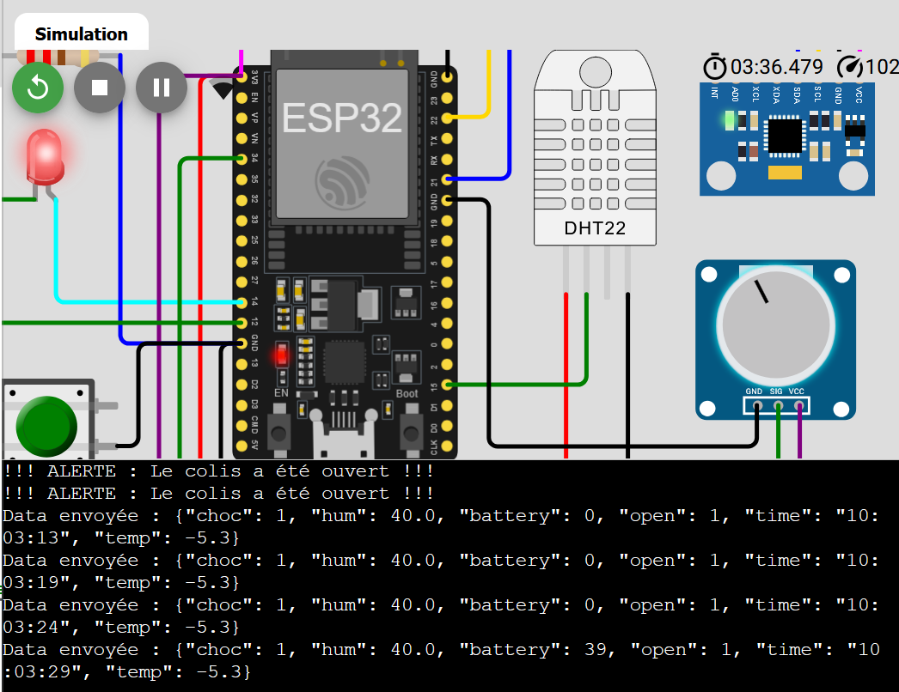

# Smart Cold Chain — Connected & Secure Monitoring of Sensitive Shipments

IoT system that monitors the transport of ultra-sensitive products (vaccines, pharmaceuticals). It does not only measure temperature: it protects the **integrity of the parcel** — temperature excursions, shocks and tampering — with local and remote alerts.

> Academic project — IoT module, ENSA Fez (GSCSI). Simulated on Wokwi.

   



---

## Architecture

```
Perception            Network      Transport / Application     Processing & visualisation
ESP32 + sensors  ──►  Wi-Fi   ──►  MQTT (JSON payload)    ──►  HiveMQ broker ──► Node-RED dashboard
(DHT22, MPU6050,                   topic: ensaf/coldchain/data
 button, battery)
```

## Hardware (4 kinds of inputs handled at once)

| Component | GPIO / bus | Role | Concept |
|---|---|---|---|
| DHT22 | GPIO 15 | Temperature & humidity | Digital input |
| MPU6050 | I2C — SDA 21, SCL 22 | Shock / fall detection | I2C bus |
| Potentiometer | GPIO 34 | Simulated battery level | ADC (11 dB attenuation, 0–4095 → 0–100 %) |
| Push button | GPIO 12 | Parcel opened (tamper) | Hardware **interrupt** (IRQ, falling edge) |
| Red LED | GPIO 14 | Immediate local alert | Digital output |

## Firmware features ([`src/main.py`](src/main.py))

- **Watchdog timer** (15 s): if the code freezes (e.g. Wi-Fi problem) the ESP32 reboots automatically — tracking is never lost.
- **Hardware interrupt** on the tamper button: the alert is handled instantly, without waiting for the main loop.
- **RTC timestamping** of every measurement to know exactly when an incident occurred.
- **Business rules:** red LED and alert if **temperature > 8 °C**, a **shock** is detected or the **parcel is opened**.
- **Resilience:** `try / except` around the loop so a network error never stops monitoring.
- **Structured data:** JSON published every 5 s over MQTT:

```json
{"time": "10:03:29", "temp": 5.2, "hum": 45, "choc": 0, "open": 1, "battery": 82}
```

- Designed with **deep sleep** in mind (≈100 mA → ≈10 µA) as the next step to run for months on a battery — not enabled in this version.

## Dashboard (Node-RED)

Gauges for temperature and battery, humidity history chart, status indicators for **shock** and **parcel opened**, and visual alerts when thresholds are exceeded.

## Test scenarios

| Scenario | Expected behaviour |
|---|---|
| Temperature raised above 8 °C | LED on + temperature alert |
| Acceleration on the MPU6050 | `choc = 1` → "PARCEL DROPPED" |
| Button pressed | `open = 1` → "TAMPERING" |
| Potentiometer turned | Battery gauge moves 0–100 % |





## Tech stack

ESP32 · MicroPython · DHT22 · MPU6050 (I2C) · ADC · IRQ · Watchdog · RTC · `umqtt.simple` · MQTT · HiveMQ · JSON · Node-RED · Wokwi
